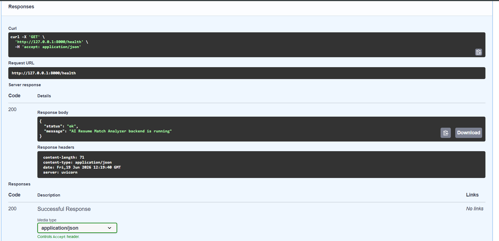
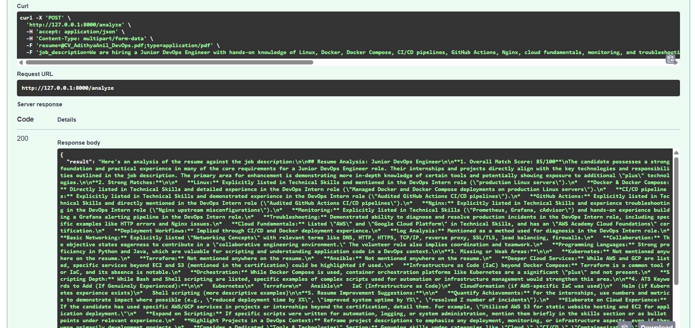
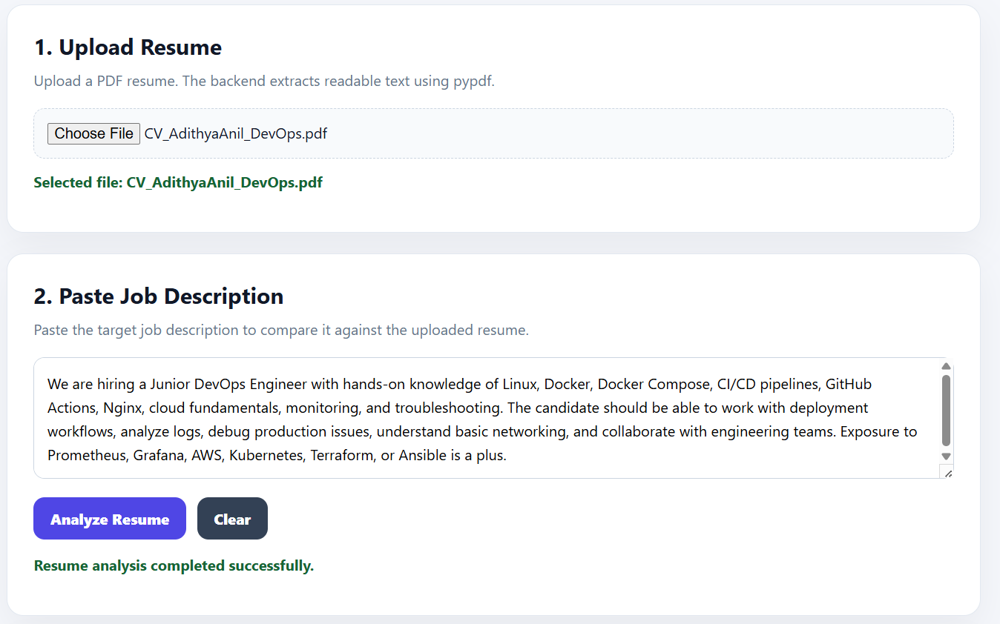
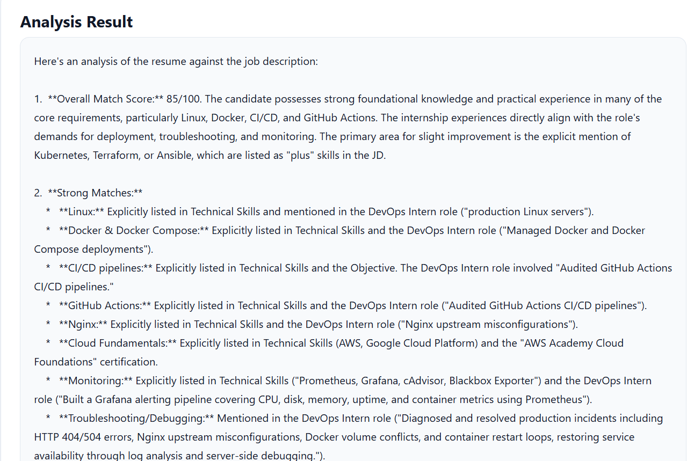
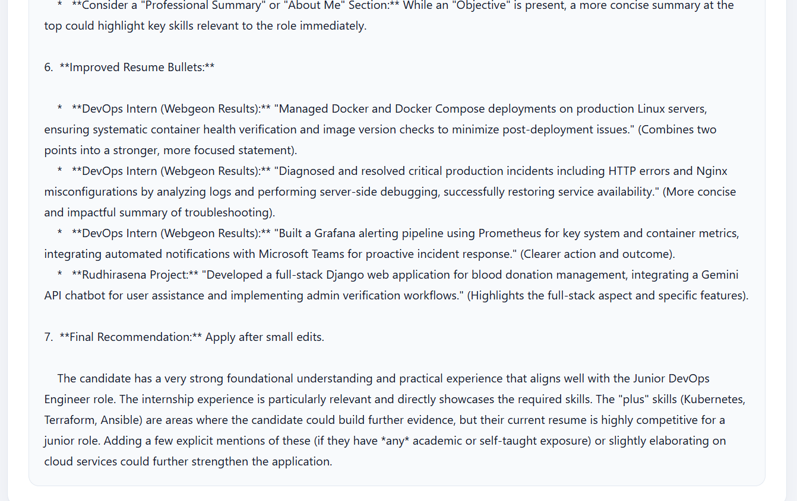

# AI Resume Match Analyzer

An AI-powered resume-to-job-description matching assistant built with FastAPI, React, Gemini, and pypdf. The application allows users to upload a resume PDF, paste a job description, and receive a structured analysis with match score, strong matches, missing skills, ATS keywords, resume improvement suggestions, improved bullets, and final application recommendation.

## Why I Built This

I built this project to understand how AI can assist with practical career workflows such as resume screening, ATS keyword matching, and job-specific resume improvement. The goal was to build a useful full-stack AI application that combines document parsing, prompt engineering, structured AI output, and frontend-backend integration.

## Features

* Upload resume PDF
* Extract readable resume text using `pypdf`
* Paste a target job description
* Analyze resume-to-JD fit using Gemini
* Generate overall match score
* Identify strong matches and missing skills
* Suggest ATS keywords to add only if genuinely applicable
* Provide resume improvement suggestions
* Rewrite improved resume bullets without exaggerating experience
* Provide final apply/edit recommendation
* React frontend for resume upload, JD input, and analysis display
* CORS-enabled frontend-backend integration

## Tech Stack

* Python
* FastAPI
* React
* Vite
* Gemini API
* pypdf
* Uvicorn
* python-dotenv

## API Endpoints

| Method | Endpoint   | Purpose                                    |
| ------ | ---------- | ------------------------------------------ |
| GET    | `/health`  | Check backend health                       |
| POST   | `/analyze` | Analyze resume PDF against job description |

## Project Architecture

```text
Resume PDF Upload
   ↓
PDF Text Extraction
   ↓
Job Description Input
   ↓
Prompt Construction
   ↓
Gemini Analysis
   ↓
Match Score + Skill Gaps + ATS Keywords + Improved Bullets
   ↓
Frontend Result Display
```

## How to Run Locally

Clone the repository:

```bash
git clone <your-repository-url>
cd ai-resume-match-analyzer/backend
```

Create and activate a virtual environment:

```bash
python -m venv venv
venv\Scripts\activate
```

Install backend dependencies:

```bash
pip install -r requirements.txt
```

Create a `.env` file inside the `backend` folder:

```env
GEMINI_API_KEY=your_gemini_api_key_here
```

Start the FastAPI backend:

```bash
uvicorn app.main:app --reload
```

Open the backend API docs:

```text
http://127.0.0.1:8000/docs
```

Start the frontend in another terminal:

```bash
cd ai-resume-match-analyzer/frontend
npm install
npm run dev
```

Open the frontend:

```text
http://localhost:5173
```

## Sample Job Description Used for Testing

```text
We are hiring a Junior DevOps Engineer with hands-on knowledge of Linux, Docker, Docker Compose, CI/CD pipelines, GitHub Actions, Nginx, cloud fundamentals, monitoring, and troubleshooting. The candidate should be able to work with deployment workflows, analyze logs, debug production issues, understand basic networking, and collaborate with engineering teams. Exposure to Prometheus, Grafana, AWS, Kubernetes, Terraform, or Ansible is a plus.
```

## Screenshots

### Backend Health Check



### Backend Analyze API



### Frontend Resume Analysis Form



### Match Score and Skill Gap Analysis



### Resume Improvement Suggestions



## What Went Wrong

While building the project, I had to handle a few practical issues:

1. The resume analysis output initially suggested fake placeholders like `X%` and `Y minutes`.
2. The AI prompt needed stricter rules to avoid exaggerated resume claims.
3. The browser frontend required CORS configuration to communicate with the FastAPI backend.
4. Resume PDF extraction depends on whether the uploaded PDF contains readable text.

## How I Fixed It

* Added prompt rules to prevent fake metrics and exaggerated experience.
* Updated improved bullet instructions to avoid numbers unless clearly present in the resume.
* Added CORS middleware in FastAPI for local frontend-backend integration.
* Added validation for PDF uploads and empty job descriptions.
* Used structured output sections to make the analysis recruiter-friendly.

## What I Learned

* AI resume analysis needs strict guardrails to avoid inventing experience.
* Prompt design directly affects output quality and trustworthiness.
* PDF parsing is simple for text-based resumes but may fail for scanned resumes.
* Full-stack AI apps need clean API contracts between frontend and backend.
* Career-focused AI tools can be built with practical workflows instead of generic chatbot interfaces.

## Future Improvements

* Add support for DOCX resumes
* Add downloadable analysis report
* Add structured JSON output from Gemini
* Add resume section-wise scoring
* Add multiple JD comparison
* Add authentication and user history
* Deploy frontend and backend
* Add Docker support after local Docker testing

## Disclaimer

This project is for educational and portfolio purposes only. The analysis should be treated as AI-assisted feedback, not as a guaranteed hiring outcome.
